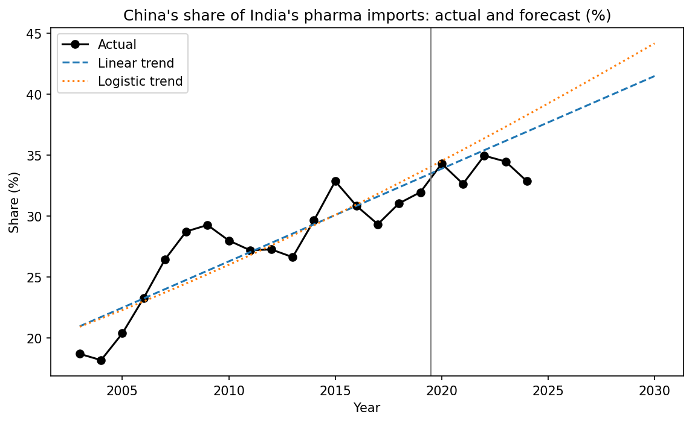
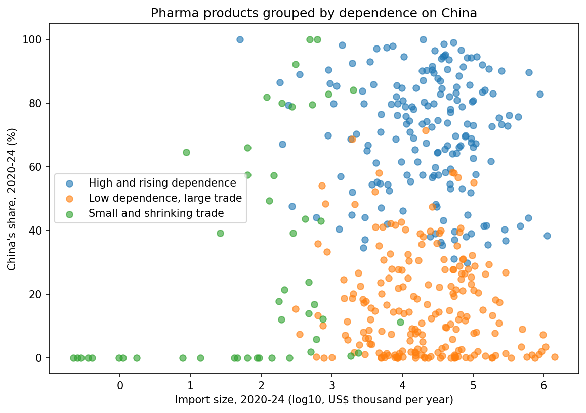
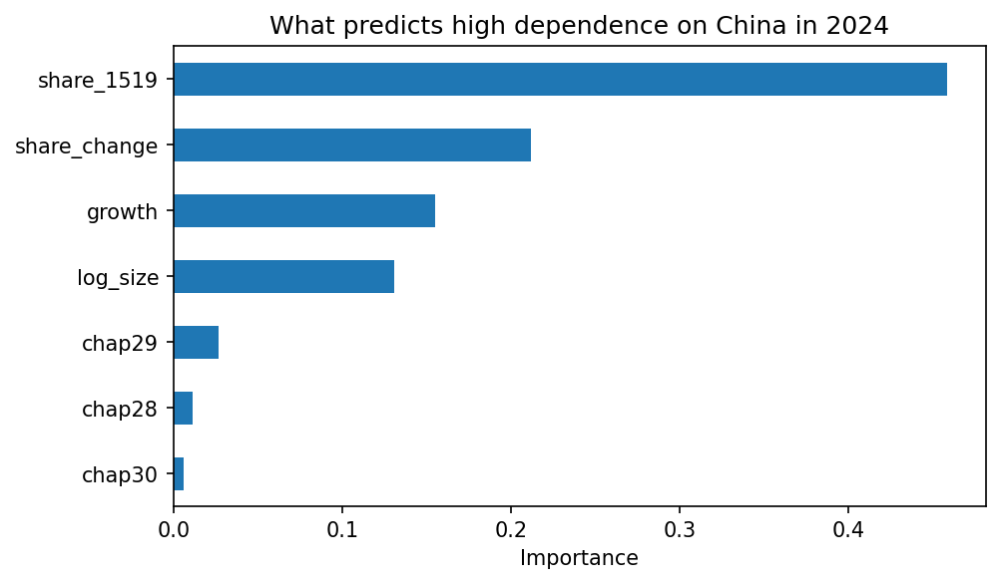

# India's Pharmaceutical Import Dependence on China, 2003 to 2024

Three Python analyses of how much India relies on China for pharmaceutical imports, using about 430 products (HS 6-digit codes) over 22 years.

**Notebook:** `project_1.ipynb` (a static copy is in `project_1.html`)

## Question

How dependent is India on China for pharmaceutical imports, and where is the dependence heading?

## What the project does

| Part | Method | Main result |
|---|---|---|
| 1. Forecast | Linear and logistic trends for China's share of India's pharma imports, trained on 2003-2019 and tested on 2020-2024 | The share rose from 18.7% (2003) to 32.9% (2024). The linear trend had the smaller test error (RMSE 2.18 against 3.08). |
| 2. Grouping | K-means clustering of 430 products on China's share, change in share, import size, and import growth | Three groups. The high and rising group has 178 products with a China share of about 70%, and 172 of them are chemicals and drug ingredients (HS 28 and 29). |
| 3. Prediction | Logistic regression and random forest, using only data up to 2019, to predict a China share above 50% in 2024 | ROC-AUC of 0.90 for the random forest, but only a small gain over a simple rule (accuracy 0.833 against 0.821). The model flagged 2 of the 43 products that crossed 50% after 2019. |

## Charts

## Files

- `project_1.ipynb` : the full notebook (code, results, and notes)
- `project_1.html` : the same notebook as a web page
- `FINAL dataset containing all.xlsx` : the data (three sheets, described below)
- `part1_*`, `part2_*`, `part3_*` : saved charts and result tables

## Data

Trade values (US$ thousand) for about 430 pharmaceutical products (HS 6-digit codes), 2003 to 2024, from WITS-Comtrade. The file `FINAL dataset containing all.xlsx` has three sheets: India's global exports (`global exports`), India's global imports (`global imports`), and India's imports from China (`china imports`).

## How to run

1. Install the packages: `pip install -r requirements.txt`
2. Put the Excel file in the same folder as the notebook.
3. Open `project_1.ipynb` in Jupyter and choose **Kernel, then Restart & Run All**.

## Limits

- The data has trade values only, with no quantities or prices, so price effects cannot be separated from volume.
- The forecast uses only 22 yearly points, and both trends overshoot the recent years because the share has levelled off at about 33% to 35% since 2020.
- The prediction adds only a small gain over the simple rule "still above 50% if it was above 50% before".
- The results show patterns, not causes.

## Author

Kalpana, MA Applied Economics, CHRIST (Deemed to be University), Bengaluru
[LinkedIn](https://www.linkedin.com/in/kalpana-037baa260)
